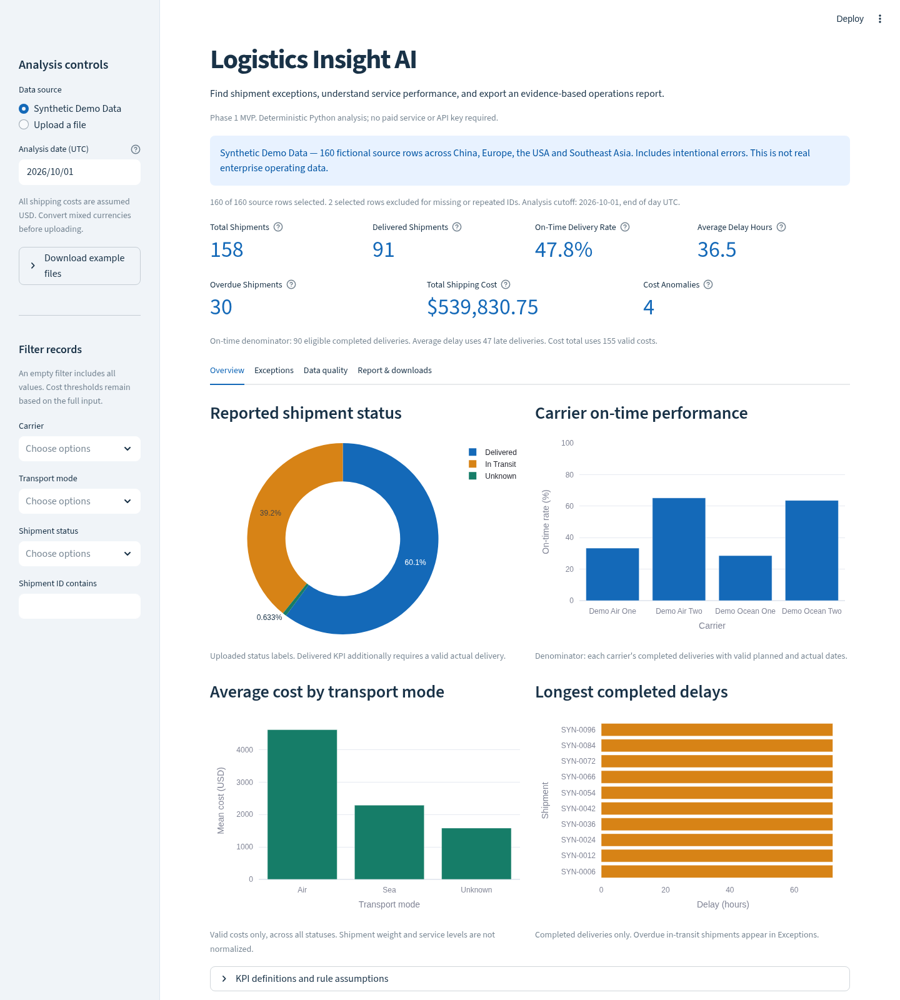
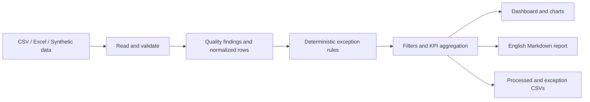

# Logistics Insight AI

A locally runnable international logistics operations app for identifying shipment
exceptions, measuring delivery performance, exploring costs, and exporting an
English business report. Built as a transport/logistics student portfolio project
with Python 3.12, Streamlit, pandas and Plotly.

**Phase 1 uses deterministic Python rules. No LLM, API key, paid service, database
or logistics company API is required.** The included **Synthetic Demo Data** is
fictional; it is not DHL, Maersk or any other company's operating data.



See the [generated example report](docs/sample_report.md) and
[actual validation results](docs/VALIDATION.md).

## Features

- Upload `.csv` or `.xlsx`, or immediately explore the built-in 160-row demo.
- Preserve source rows and raw values while normalizing IDs, dates, statuses and costs.
- Review missing values, invalid dates/costs, duplicate IDs and date/status conflicts.
- Keep completed delays separate from overdue in-transit shipments.
- Screen relative high costs within comparable mode and directional route groups.
- Explore seven KPIs, status distribution, carrier on-time performance, average
  cost by mode and a ranking of completed delays.
- Filter by carrier, transport mode, status or shipment ID. Metrics, tables,
  exports and reports all reflect the same selection.
- Download processed orders CSV, exceptions CSV and a calculated English Markdown report.
- Run independently tested business logic and Streamlit UI tests.

## Quick start

Prerequisites: Python **3.12** with pip and venv, and this repository downloaded or
cloned onto your computer. Run these commands from the repository root.

### macOS / Linux

```bash
python3.12 -m venv .venv
source .venv/bin/activate
python -m pip install -r requirements.txt
python -m streamlit run app.py
```

### Windows PowerShell

```powershell
py -3.12 -m venv .venv
.\.venv\Scripts\python.exe -m pip install -r requirements.txt
.\.venv\Scripts\python.exe -m streamlit run app.py
```

Streamlit prints the local browser address when it starts. On your computer,
open that address; stop the app with **Ctrl+C** in the terminal. The app runs
locally and does not need account registration. Internet is needed to install
dependencies, but the demo analysis and reports work without external services.

### Try the complete demo workflow

1. Launch the app. `Synthetic Demo Data` is selected by default.
2. Keep the analysis date at **2026-10-01** for a reproducible demo snapshot.
3. Explore Overview, Exceptions and Data quality. Change filters to inspect a carrier or mode.
4. Open Report & downloads to read the English report and download all three outputs.
5. To exercise upload, select `Upload a file`, choose either file under `data/`,
   and set the analysis date to **2026-10-01** again. Uploaded files default to today's UTC date.

With no filters at that reference date, the included demo produces:

| Measure | Calculated result |
| --- | ---: |
| Source rows / retained unique shipments | 160 / 158 |
| Verified delivered shipments / eligible deliveries | 91 / 90 |
| On-Time Delivery Rate | 47.8% (43 / 90) |
| Completed delayed deliveries | 47 |
| Average Delay Hours | 36.5 |
| Overdue Shipments | 30 |
| Total Shipping Cost | USD 539,830.75 across 155 valid costs |
| Cost Anomalies | 4 |

These numbers are computed from synthetic examples and are **not performance
claims** about real logistics operations.

## Input data contract

CSV must be comma-separated UTF-8 (a UTF-8 BOM is supported). For Excel, the first
worksheet is read. Both formats must have column headers on the first row.
Headers are trimmed and lowercased. IDs are read as text, preserving leading zeroes.
The local MVP accepts up to 20 MB and 100,000 data rows per upload.

| Column | Meaning / accepted input |
| --- | --- |
| `shipment_id` | Nonblank shipment identifier; case-sensitive after trimming |
| `origin` | Origin label, preferably city and country |
| `destination` | Destination label, preferably city and country |
| `transport_mode` | Air, Sea, Road or Rail; Ocean is an alias for Sea |
| `carrier` | Carrier name; fictional names in demo data |
| `planned_delivery` | ISO planned date/time |
| `actual_delivery` | ISO actual date/time; leave blank while not delivered |
| `shipping_cost` | Finite nonnegative USD number; valid thousands separators accepted |
| `status` | Delivered, In Transit, Pending, Delivery Failed or Returned |
| `shipped_at` (optional) | ISO shipment start date/time for chronology checks |

Status and transport mode aliases are case-insensitive; `in_transit` is accepted.
Unsupported values become `Unknown` with a reviewable data quality finding.
Dates must be `YYYY-MM-DD` or ISO timestamps such as `2026-09-30T12:00:00Z` or
`2026-09-30T14:00:00+02:00`. Ambiguous dates such as `01/02/2026`, unformatted
Excel date serials and invalid calendar dates are rejected at field level.
Native formatted Excel date cells are supported through openpyxl.

Naive dates are interpreted as UTC; date-only events occur at midnight. The
selected analysis day ends at 23:59:59.999999999 UTC. Dates before 2000-01-01 are
flagged as implausible. Earlier actual delivery than planned delivery is valid.
`actual_delivery < shipped_at` is invalid when shipped_at is supplied. A malformed
supplied shipped_at prevents trustworthy temporal comparisons. Without shipped_at,
the app cannot infer a shipment's actual starting time.

### Handling imperfect data

- Missing required **columns** or unreadable files produce an actionable message.
  A header-only table produces an empty dashboard; empty bytes produce an input message.
- Missing IDs and subsequent duplicate IDs are excluded from shipment KPIs;
  the **first occurrence is retained**, even if a later occurrence looks better.
  All source rows remain available for review/export. This is not an automated merge.
- Other field errors do not discard the whole shipment. Invalid cost is excluded
  only from cost metrics; invalid planned dates exclude the on-time/overdue comparison.
- `Delivered` without a valid actual date is unverified and excluded from delivered
  and on-time counts. A future actual date is not counted as completed at the cutoff.
- Non-delivered statuses with a supplied actual date are flagged as conflicting;
  they are not silently converted to completed deliveries or assumed overdue.
- Missing carrier/location labels become `Unknown`. Incomplete mode/route labels
  cannot form a valid comparable cost group.
- Data quality findings include the original source row (header is row 1), field,
  raw value, severity and explanation. Processed exports retain `*_raw` fields.

## KPI definitions

All headline KPIs use the filtered selection after missing-ID and duplicate-row
exclusions. Per-field eligibility can reduce the denominator further.

| KPI | Definition |
| --- | --- |
| Total Shipments | Count of retained unique nonblank shipment IDs, even when other fields need review |
| Delivered Shipments | Retained status Delivered, valid actual date at/before the cutoff, and valid actual chronology |
| On-Time Delivery Rate | On-time eligible deliveries / all eligible deliveries; eligibility additionally requires a valid planned date and planned chronology |
| Average Delay Hours | Mean of positive `(actual - planned)` hours among eligible **late completed deliveries only**; zero if eligible deliveries exist but none is late; otherwise N/A |
| Overdue Shipments | Retained In Transit, valid planned time before cutoff, no supplied actual delivery, and valid planned chronology |
| Total Shipping Cost | Sum of valid nonnegative costs across retained shipments of all statuses; invalid/missing costs are excluded, not treated as zeros |
| Cost Anomalies | Retained high-cost shipments in a comparable group with at least 8 valid costs |

In-transit shipments never enter the completed-delivery on-time denominator.
A `Pending`, `Delivery Failed` or `Returned` status is reviewable but is not an
In Transit shipment under the overdue rule. Changing the reference date does not
reconstruct historical statuses, invoices or historical costs.

### Cost rule

Group by **transport mode + origin + destination**, with directional routes and
case-insensitive location comparison (internal whitespace normalized). Exclude
invalid costs, unidentified/duplicate rows and missing grouping labels.

For at least **8 valid observations**:

```text
median = median(group costs)
MAD = median(abs(cost - median))
upper threshold = median + max(3.5 × 1.4826 × MAD, 0.5 × median)
high cost = shipping_cost > upper threshold
```

The 50% median margin avoids flagging tiny differences in groups with zero or very
small MAD. Smaller groups are **Insufficient data**, not normal and not anomalous.
This configurable-in-code rule is a documented screening assumption, not an
industry standard or proof of incorrect billing. Thresholds are computed on the
complete upload **before** filters and remain fixed when filtering.

## Architecture and project structure

```text
app.py                     Streamlit UI, filters, charts and downloads
src/
  schema.py                Input contract, constants, KPI definitions
  ingestion.py             CSV/Excel loading and file/schema validation
  analysis.py              Quality rules, delay/overdue/cost rules and KPIs
  reporting.py             Deterministic English report and ReportGenerator interface
  exports.py               Spreadsheet-safe CSV downloads
  demo.py                  Reproducible synthetic dataset and Excel workbook
data/                      Labelled synthetic CSV, Excel and provenance notes
tests/                     Core rules, input/output, reports and Streamlit tests
  browser_smoke.py          Optional real-browser upload/download verification
docs/                      Browser screenshots, sample report and validation evidence
.streamlit/config.toml     Local app settings and visual theme
.github/workflows/tests.yml Python 3.12 CI checks (runs after push)
.agents/skills/            Previously installed development skills
requirements.txt           Pinned direct runtime/test dependencies
requirements-dev.txt       Optional Playwright browser test dependency
```



The business layer does not import Streamlit. There is no database or upload
directory; uploaded bytes are processed in memory. Browser sessions hold their
own selections. Do not upload sensitive data to a publicly shared deployment.
Downloaded CSVs escape formula-like text with an apostrophe to prevent spreadsheet
formula execution; numeric costs stay numeric. Raw values are unchanged in the app.

`ReportGenerator` is a small Python protocol for a future optional AI adapter.
The default `RuleBasedReportGenerator` calculates every reported number, makes no
causal claims and works without credentials. No `.env` file is needed.

## Tests and verification

From the activated virtual environment:

```bash
python -m pytest -q
python -m compileall -q app.py src tests
python -m pip check
```

Tests include hand-calculated KPI examples, no delays, all in transit, invalid
dates, missing actual dates, duplicates, empty inputs/tables, insufficient cost
samples, outlier thresholds, temporal/status conflicts, input immutability,
both demo file formats, English report figures, export escaping, UI filters and
empty UI states. CI runs the standard suite without browser installation.

Optional browser tests verify real CSV/Excel upload and all three downloads:

```bash
python -m pip install -r requirements-dev.txt
python -m playwright install chromium
python -m streamlit run app.py
# In a second terminal with the same virtual environment active:
python tests/browser_smoke.py
```

If using a system Chromium installation instead, set `BROWSER_EXECUTABLE_PATH`.
The smoke test defaults to the app's local port 8501; `APP_BASE_URL` can override
it. Screenshots and downloaded files go to ignored `artifacts/browser/`.

Regenerate the two fictional example files with `python -m src.demo`.
The generator intentionally overwrites those named demo files, not uploads.

## Known limitations

- Synthetic fixtures test implemented behavior; they do not establish real-world
  predictive accuracy or represent actual carrier operating performance.
- Order snapshots do not explain customs, port, weather or operational root causes.
  Reports recommend verification rather than inventing explanations.
- All prices must use USD. No exchange-rate conversion, weight/volume normalization,
  service-level adjustment or seasonal cost model is included.
- Exact location labels are not geocoded or mapped to UN/LOCODE. Equivalent spellings
  beyond case and whitespace may form different groups.
- Data is analyzed in memory with local-sized limits. There is no persistence,
  authentication, scheduling, live tracking or production deployment configuration.
- Only the first Excel worksheet and UTF-8 comma-separated CSVs are read. Badly
  structured CSV records, password-protected/corrupt workbooks or a missing schema
  need correction before upload; ordinary invalid field values are reviewable.
- Date-only fields lose within-day precision. UTC is a documented assumption,
  not an automatic conversion from an unknown local timezone.
- Requirements pin direct packages; transitive dependencies remain resolver-managed.
  Browser automation is optional and separate from the core install.

## Next phase

1. Add event-level milestone data and a labelled evaluation set, so delay reasons
   and detection accuracy can be verified against real, anonymized cases.
2. Improve comparable costs using weight, currency, service level and route codes;
   make business thresholds editable with validation and an audit trail.
3. Add optional evidence-grounded AI explanations/SOP retrieval through the report
   interface, with citations and a deterministic no-key fallback.

## 中文运行说明（新手版）

1. 安装 Python 3.12，下载本仓库并解压。在项目文件夹内打开终端；
   确认这里能看到 `app.py` 和 `requirements.txt`。
2. Windows 直接复制上面的 PowerShell 三行命令；macOS/Linux 使用对应的四行命令。
   其中 `.venv` 是项目自己的 Python 环境，不会修改系统 Python。
3. 安装完成后运行 `python -m streamlit run app.py`（Windows 可使用上面的完整路径命令），
   打开终端显示的本地浏览器地址。
4. 默认就能查看 **Synthetic Demo Data（模拟演示数据）**。也可以选择
   `Upload a file`，上传 `data/` 内的 CSV 或 Excel。
   演示数据的分析日期应设为 **2026-10-01**，与 README 结果一致。
5. `Exceptions` 查看异常；`Data quality` 查看错误原值；
   `Report & downloads` 下载处理结果、异常清单和英文报告。
6. 想结束运行，在终端按 `Ctrl+C`。下次进入项目后再次启动即可，通常无需重复安装。

第一版不需要 API Key，也不会自动访问物流公司的接口。报告中的原因建议只是待核实行动，
不会把猜测写成真实事件。项目名称中的 AI 表示后续扩展方向；当前分析由可测试的 Python 规则完成。
