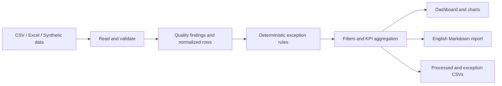

# Logistics Insight AI

A **Lightweight, Explainable Logistics Exception Decision Copilot for Small
Freight Forwarders**. Identify exceptions, prioritize cases with sufficient
information, compare hypothetical interventions and record handling outcomes.
Built as a transport/logistics student portfolio project with Python 3.12,
Streamlit, pandas, Plotly and local SQLite.

**V2 extends the working V1 dashboard with deterministic decision support. No LLM,
API key, paid service or logistics company API is required.** This is an engineering
prototype evaluated on **Synthetic Demo Data**, not a live carrier network or a
validated forecasting system. It is not DHL, Maersk or any company's operating data.


See the [generated example report](docs/sample_report.md) and
[actual validation results](docs/VALIDATION.md).

## Features

- Upload `.csv` or `.xlsx`, or immediately explore the built-in 160-row demo.
- Preserve source rows and raw values while normalizing IDs, dates, statuses and costs.
- Review missing values, invalid dates/costs, duplicate IDs and date/status conflicts.
- Keep completed delays separate from overdue in-transit shipments.
- Screen relative high costs within comparable mode and directional route groups.
- Explore seven KPIs, status distribution, carrier on-time performance, average
  cost by mode and a ranking of completed delays.
- Filter by carrier, transport mode, status or shipment ID. Metrics, tables,
  exports and reports all reflect the same selection.
- Download processed orders CSV, exceptions CSV and a calculated English Markdown report.
- Run independently tested business logic and Streamlit UI tests.
- Configure explainable five-component priorities with a separate missing-information lane.
- Edit costs, remaining time and availability assumptions for three intervention scenarios.
- Persist decisions and manually entered outcomes in SQLite; query, update and match similar cases.
- Reproduce V1/V2 comparisons and weight/assumption sensitivity on independently authored synthetic references.

## Quick start

Prerequisites: Python **3.12** with pip and venv, and this repository downloaded or
cloned onto your computer. Run these commands from the repository root.

### macOS / Linux

```bash
python3.12 -m venv .venv
source .venv/bin/activate
python -m pip install -r requirements.txt
python -m streamlit run app.py
```

### Windows PowerShell

```powershell
py -3.12 -m venv .venv
.\.venv\Scripts\python.exe -m pip install -r requirements.txt
.\.venv\Scripts\python.exe -m streamlit run app.py
```

Streamlit prints the local browser address when it starts. On your computer,
open that address; stop the app with **Ctrl+C** in the terminal. The app runs
locally and does not need account registration. Internet is needed to install
dependencies, but the demo analysis and reports work without external services.

**Windows beginner note:** enter these commands in PowerShell or cmd, not in the
Python `>>>` window. In File Explorer, open the folder containing `app.py` and
`requirements.txt`, type `cmd` in the address bar, and press Enter. Launch through
Streamlit rather than double-clicking `app.py`.

### Try the complete demo workflow

1. Launch the app. `Synthetic Demo Data` is selected by default.
2. Keep the analysis date at **2026-10-01** for a reproducible demo snapshot.
3. Explore Overview, Exceptions and Data quality. Change filters to inspect a carrier or mode.
4. Open Report & downloads to read the English report and download all three outputs.
5. Open Priority queue, Decision Center, Case history and Evaluation for V2.
   The built-in demo adds explicitly fictional decision context; the original V1 KPIs stay identical.
6. To exercise upload, select `Upload a file`, choose either V1 file under `data/`,
   and set the analysis date to **2026-10-01** again. Uploaded files default to today's UTC date.
   `data/synthetic_decision_shipments.csv` additionally includes fictional V2 context.
   V1-only files remain supported; missing V2 inputs are shown as insufficient information.

With no filters at that reference date, the included demo produces:

| Measure | Calculated result |
| --- | ---: |
| Source rows / retained unique shipments | 160 / 158 |
| Verified delivered shipments / eligible deliveries | 91 / 90 |
| On-Time Delivery Rate | 47.8% (43 / 90) |
| Completed delayed deliveries | 47 |
| Average Delay Hours | 36.5 |
| Overdue Shipments | 30 |
| Total Shipping Cost | USD 539,830.75 across 155 valid costs |
| Cost Anomalies | 4 |

These numbers are computed from synthetic examples and are **not performance
claims** about real logistics operations.

## Input data contract

CSV must be comma-separated UTF-8 (a UTF-8 BOM is supported). For Excel, the first
worksheet is read. Both formats must have column headers on the first row.
Headers are trimmed and lowercased. IDs are read as text, preserving leading zeroes.
The local MVP accepts up to 20 MB and 100,000 data rows per upload.

| Column | Meaning / accepted input |
| --- | --- |
| `shipment_id` | Nonblank shipment identifier; case-sensitive after trimming |
| `origin` | Origin label, preferably city and country |
| `destination` | Destination label, preferably city and country |
| `transport_mode` | Air, Sea, Road or Rail; Ocean is an alias for Sea |
| `carrier` | Carrier name; fictional names in demo data |
| `planned_delivery` | ISO planned date/time |
| `actual_delivery` | ISO actual date/time; leave blank while not delivered |
| `shipping_cost` | Finite nonnegative USD number; valid thousands separators accepted |
| `status` | Delivered, In Transit, Pending, Delivery Failed or Returned |
| `shipped_at` (optional) | ISO shipment start date/time for chronology checks |

Status and transport mode aliases are case-insensitive; `in_transit` is accepted.
Unsupported values become `Unknown` with a reviewable data quality finding.
Dates must be `YYYY-MM-DD` or ISO timestamps such as `2026-09-30T12:00:00Z` or
`2026-09-30T14:00:00+02:00`. Ambiguous dates such as `01/02/2026`, unformatted
Excel date serials and invalid calendar dates are rejected at field level.
Native formatted Excel date cells are supported through openpyxl.

Naive dates are interpreted as UTC; date-only events occur at midnight. The
selected analysis day ends at 23:59:59.999999999 UTC. Dates before 2000-01-01 are
flagged as implausible. Earlier actual delivery than planned delivery is valid.
`actual_delivery < shipped_at` is invalid when shipped_at is supplied. A malformed
supplied shipped_at prevents trustworthy temporal comparisons. Without shipped_at,
the app cannot infer a shipment's actual starting time.

### Handling imperfect data

- Missing required **columns** or unreadable files produce an actionable message.
  A header-only table produces an empty dashboard; empty bytes produce an input message.
- Missing IDs and subsequent duplicate IDs are excluded from shipment KPIs;
  the **first occurrence is retained**, even if a later occurrence looks better.
  All source rows remain available for review/export. This is not an automated merge.
- Other field errors do not discard the whole shipment. Invalid cost is excluded
  only from cost metrics; invalid planned dates exclude the on-time/overdue comparison.
- `Delivered` without a valid actual date is unverified and excluded from delivered
  and on-time counts. A future actual date is not counted as completed at the cutoff.
- Non-delivered statuses with a supplied actual date are flagged as conflicting;
  they are not silently converted to completed deliveries or assumed overdue.
- Missing carrier/location labels become `Unknown`. Incomplete mode/route labels
  cannot form a valid comparable cost group.
- Data quality findings include the original source row (header is row 1), field,
  raw value, severity and explanation. Processed exports retain `*_raw` fields.

## KPI definitions

All headline KPIs use the filtered selection after missing-ID and duplicate-row
exclusions. Per-field eligibility can reduce the denominator further.

| KPI | Definition |
| --- | --- |
| Total Shipments | Count of retained unique nonblank shipment IDs, even when other fields need review |
| Delivered Shipments | Retained status Delivered, valid actual date at/before the cutoff, and valid actual chronology |
| On-Time Delivery Rate | On-time eligible deliveries / all eligible deliveries; eligibility additionally requires a valid planned date and planned chronology |
| Average Delay Hours | Mean of positive `(actual - planned)` hours among eligible **late completed deliveries only**; zero if eligible deliveries exist but none is late; otherwise N/A |
| Overdue Shipments | Retained In Transit, valid planned time before cutoff, no supplied actual delivery, and valid planned chronology |
| Total Shipping Cost | Sum of valid nonnegative costs across retained shipments of all statuses; invalid/missing costs are excluded, not treated as zeros |
| Cost Anomalies | Retained high-cost shipments in a comparable group with at least 8 valid costs |

In-transit shipments never enter the completed-delivery on-time denominator.
A `Pending`, `Delivery Failed` or `Returned` status is reviewable but is not an
In Transit shipment under the overdue rule. Changing the reference date does not
reconstruct historical statuses, invoices or historical costs.

### Cost rule

Group by **transport mode + origin + destination**, with directional routes and
case-insensitive location comparison (internal whitespace normalized). Exclude
invalid costs, unidentified/duplicate rows and missing grouping labels.

For at least **8 valid observations**:

```text
median = median(group costs)
MAD = median(abs(cost - median))
upper threshold = median + max(3.5 × 1.4826 × MAD, 0.5 × median)
high cost = shipping_cost > upper threshold
```

The 50% median margin avoids flagging tiny differences in groups with zero or very
small MAD. Smaller groups are **Insufficient data**, not normal and not anomalous.
This configurable-in-code rule is a documented screening assumption, not an
industry standard or proof of incorrect billing. Thresholds are computed on the
complete upload **before** filters and remain fixed when filtering.

## Architecture and project structure

```text
app.py                     Streamlit UI, filters, charts and downloads
src/
  schema.py                Input contract, constants, KPI definitions
  ingestion.py             CSV/Excel loading and file/schema validation
  analysis.py              Quality rules, delay/overdue/cost rules and KPIs
  reporting.py             Deterministic English report and ReportGenerator interface
  exports.py               Spreadsheet-safe CSV downloads
  demo.py                  Reproducible synthetic dataset and Excel workbook
  priority.py              Configurable, evidence-explicit exception triage
  decisions.py             Editable deterministic what-if action comparisons
  history.py               Local SQLite records, updates and exact case matching
  evaluation.py            Independent synthetic reference comparisons and sensitivity
  decision_demo.py         Optional fictional context without changing V1 inputs
  copilot_ui.py            V2 Streamlit views
config/priority_rules.json Default weights, scales and priority thresholds
data/                      Labelled synthetic CSV, Excel and provenance notes
tests/                     Core rules, input/output, reports and Streamlit tests
  browser_smoke.py          Optional real-browser upload/download verification
docs/                      Browser screenshots, sample report and validation evidence
.streamlit/config.toml     Local app settings and visual theme
.github/workflows/tests.yml Python 3.12 CI checks (runs after push)
.agents/skills/            Previously installed development skills
requirements.txt           Pinned direct runtime/test dependencies
requirements-dev.txt       Optional Playwright browser test dependency
```



The business logic modules do not import Streamlit; `copilot_ui.py` is a separate
presentation module. Uploaded bytes are processed in memory, while SQLite stores
saved handling history locally. Browser sessions hold their
own selections. Do not upload sensitive data to a publicly shared deployment.
Downloaded CSVs escape formula-like text with an apostrophe to prevent spreadsheet
formula execution; numeric costs stay numeric. Raw values are unchanged in the app.

`ReportGenerator` is a small Python protocol for a future optional AI adapter.
The default `RuleBasedReportGenerator` calculates every reported number, makes no
causal claims and works without credentials. No `.env` file is needed.

## Tests and verification

From the activated virtual environment:

```bash
python -m pytest -q
python -m compileall -q app.py src tests
python -m pip check
```

Tests include hand-calculated KPI examples, no delays, all in transit, invalid
dates, missing actual dates, duplicates, empty inputs/tables, insufficient cost
samples, outlier thresholds, temporal/status conflicts, input immutability,
both demo file formats, English report figures, export escaping, UI filters and
empty UI states. CI runs the standard suite without browser installation.

Optional browser tests verify real CSV/Excel upload and all three downloads:

```bash
python -m pip install -r requirements-dev.txt
python -m playwright install chromium
python -m streamlit run app.py
# In a second terminal with the same virtual environment active:
python tests/browser_smoke.py
```

If using a system Chromium installation instead, set `BROWSER_EXECUTABLE_PATH`.
The smoke test defaults to the app's local port 8501; `APP_BASE_URL` can override
it. Screenshots and downloaded files go to ignored `artifacts/browser/`.

Regenerate the two fictional example files with `python -m src.demo`.
The generator intentionally overwrites those named demo files, not uploads.

## Known limitations

- Synthetic fixtures test implemented behavior; they do not establish real-world
  predictive accuracy or represent actual carrier operating performance.
- Order snapshots do not explain customs, port, weather or operational root causes.
  Reports recommend verification rather than inventing explanations.
- All prices must use USD. No exchange-rate conversion, weight/volume normalization,
  service-level adjustment or seasonal cost model is included.
- Exact location labels are not geocoded or mapped to UN/LOCODE. Equivalent spellings
  beyond case and whitespace may form different groups.
- Uploaded data is analyzed in memory with local-sized limits. Only explicitly
  saved case history persists in local SQLite. There is no authentication,
  scheduling, live tracking or production deployment configuration.
- Only the first Excel worksheet and UTF-8 comma-separated CSVs are read. Badly
  structured CSV records, password-protected/corrupt workbooks or a missing schema
  need correction before upload; ordinary invalid field values are reviewable.
- Date-only fields lose within-day precision. UTC is a documented assumption,
  not an automatic conversion from an unknown local timezone.
- Requirements pin direct packages; transitive dependencies remain resolver-managed.
  Browser automation is optional and separate from the core install.

## Next phase

1. Add event-level milestone data and a labelled evaluation set, so delay reasons
   and detection accuracy can be verified against real, anonymized cases.
2. Improve comparable costs using weight, currency, service level and route codes;
   make business thresholds editable with validation and an audit trail.
3. Add optional evidence-grounded AI explanations/SOP retrieval through the report
   interface, with citations and a deterministic no-key fallback.

## 中文运行说明（新手版）

1. 安装 Python 3.12，下载本仓库并解压。在项目文件夹内打开终端；
   确认这里能看到 `app.py` 和 `requirements.txt`。
2. Windows 直接复制上面的 PowerShell 三行命令；macOS/Linux 使用对应的四行命令。
   其中 `.venv` 是项目自己的 Python 环境，不会修改系统 Python。
3. 安装完成后运行 `python -m streamlit run app.py`（Windows 可使用上面的完整路径命令），
   打开终端显示的本地浏览器地址。
4. 默认就能查看 **Synthetic Demo Data（模拟演示数据）**。也可以选择
   `Upload a file`，上传 `data/` 内的 CSV 或 Excel。
   演示数据的分析日期应设为 **2026-10-01**，与 README 结果一致。
5. `Exceptions` 查看异常；`Data quality` 查看错误原值；
   `Report & downloads` 下载处理结果、异常清单和英文报告。
6. 想结束运行，在终端按 `Ctrl+C`。下次进入项目后再次启动即可，通常无需重复安装。

V1 和 V2 都不需要 API Key，也不会访问物流公司的接口。新增标签页可查看优先级、修改模拟方案、
保存及更新处理历史，并运行对照评估。缺少评分信息时显示 Insufficient information，不假定低风险。
历史保存在本地 `data/local/`，重新下载代码更新时请保留这个目录。
报告和决策建议不会把猜测写成真实事件；当前分析由可测试的 Python 规则完成。

## Product differentiation

The product supports an explicit operations decision loop: **detect → triage →
compare assumptions → record a human choice → enter outcomes → review similar cases**.
It is intended for small freight forwarders exploring explainable exception handling,
not autonomous booking or proven loss prevention. All V1 tabs, KPI definitions,
file formats, downloads and the `streamlit run app.py` launch command remain available.

Running-app views: [priority queue](docs/images/v2-priority-queue.png),
[Decision Center](docs/images/v2-decision-center.png),
[case history](docs/images/v2-case-history.png).

| Capability | Traditional descriptive dashboard | This prototype |
| --- | --- | --- |
| Identify late/overdue/cost records | Lists and visualizes exceptions | Retains the V1 deterministic dashboard |
| Decide what to investigate first | Usually left to the operator | Configurable score with contributions, evidence requirements and missing-information lane |
| Explore interventions | Separate spreadsheet or manual discussion | Three editable what-if scenarios with visible deadline effects and assumptions |
| Close the handling loop | Often outside the dashboard | SQLite case history with estimates, actuals, status, notes and saved assumptions |
| Test sensitivity | Not always explicit | Repeatable weight and scenario comparisons on independent synthetic teaching references |

This comparison describes the implemented workflow, not a benchmark against
commercial logistics software. Real-world usefulness has not been validated.

## Decision methodology

### Priority eligibility and missing information

Only retained **In Transit** V1 exceptions with no reported actual delivery receive
an active transport priority. Completed/non-transit/conflicting records are
`Review only`; unidentified/duplicate rows are `Excluded`. A normal V1 record is
`Not an exception`. Retrospective V1 exceptions remain visible and exportable.

Each enabled component maps to [0, 1]. Default weights total 100:

| Component | Default weight | Rule and necessary input |
| --- | ---: | --- |
| Delivery deadline urgency | 30 | `clip(1 - hours_until_deadline / 72, 0, 1)`; explicit ISO `delivery_deadline`, otherwise valid V1 `planned_delivery` |
| Estimated delay severity | 25 | `min(estimated_delay_hours / 72, 1)`; explicitly supplied nonnegative estimate, never inferred from overdue age |
| Potential financial impact | 20 | `min(estimated_financial_impact / 10000, 1)`; estimate **and** nonblank `financial_impact_basis` |
| Shipment value | 10 | `min(shipment_value / 100000, 1)`; exposure context only, never treated as actual loss |
| Downstream disruption proxy | 15 | `min(downstream_dependency_count / 5, 1)`; nonnegative integer **and** nonblank `downstream_risk_basis` |

```text
Priority Score = 100 × sum(weight × component) / sum(enabled weights)
High >= 70; Medium >= 40; otherwise Low
```

Scores are rounded to four decimal places before level assignment, so a displayed
score exactly at a configured threshold receives the corresponding level.

All enabled components must be valid for a complete score. Missing values are
**not zero-filled and not renormalized away**. Such records have no Priority Score,
show `Insufficient information`, list the missing/invalid inputs, and stay in a
separate information-needed lane. Coverage is the percentage of enabled weight
with known inputs. Optional lower/upper bounds assume missing components could
span [0,1]; these are not confidence intervals or a ranking of incomplete records.

An invalid explicitly supplied deadline does not silently fall back to the plan.
An early valid planned delivery remains valid under V1. A nonblank basis documents
what the user supplied; it is not independent verification that the claim is true.
All monetary inputs are USD and all date comparisons use the selected UTC cutoff.

Edit weights, scales and thresholds in Priority queue. Zero disables a component;
all-zero/negative/non-finite settings and inverted thresholds are rejected without
breaking V1. Defaults are in `config/priority_rules.json`; the UI can download the
current settings. UI edits last for the session, while each saved case retains its
own scoring configuration snapshot.

### Optional upload fields

V1 requires no new columns. For V2 triage, add:

```text
delivery_deadline, estimated_delay_hours, estimated_financial_impact,
financial_impact_basis, shipment_value, downstream_dependency_count,
downstream_risk_basis, decision_context_source
```

`delivery_deadline` and `decision_context_source` are optional metadata; a valid plan
can supply the deadline fallback. The source label does not validate the inputs.
The other context fields are required only when their corresponding weight is enabled.
`python -m src.decision_demo` regenerates the separate 160-row fictional decision file.
The original V1 demo CSV and workbook stay unchanged.

### Action comparison

Decision Center compares **Wait and monitor**, **Request expedited handling**, and
**Alternative transport arrangement** for an active exception. Initial values are
explicit simulation assumptions: incremental costs USD 0 / 250 / 800, remaining
times 96 / 48 / 24 hours. Availability is also an assumption, not carrier confirmation.
Edit all three options' cost, remaining time, notes and assumed availability.
These what-if inputs are independent of the supplied delay estimate used in
priority scoring. Scenario edits do not overwrite shipment facts or automatically
rescore priorities. This is not a total expected-cost optimizer: no penalty or
damage cost is invented from delay or cargo value.

```text
scenario arrival = selected UTC cutoff + assumed remaining hours
estimated delay = max(0, scenario arrival - selected deadline), in hours
```

The UI labels these illustrative arrivals rather than guaranteed ETAs and shows
them at minute precision; calculations retain the recorded analysis cutoff. If a deadline
is unknown, delay and deadline impact remain unknown; costs may still be compared.
Unavailable options have no arrival/delay outcome and cannot be selected for saving.
No action is automatically recommended, booked, purchased or sent to a carrier.

### Local handling history

An explicit Save creates one SQLite case containing shipment ID, exception type,
selected action, estimated additional cost/delay, actual additional cost/delay,
resolution status and notes. Actuals initially use SQL NULL, **not zero**. Resolution
status may be Open, In Progress, Resolved or Cancelled; recording Resolved does not
invent an actual cost or delay. Actual cost uses the same **incremental USD** basis
as estimated cost; delay is lateness against the case's selected deadline in hours.

Saved context includes route/mode/carrier, analysis date, all action assumptions
and the priority snapshot. History supports exact ID/status/exception filters,
CSV download, explicit status/outcome updates, timestamps and optimistic version
checks to reject stale concurrent updates. Similarity requires exact directional
route + mode + exception type, ignoring case and whitespace, and excludes the
current shipment. No matching case means no historical evidence, not a guessed outcome.

Default database: `data/local/exception_history.sqlite3`. It is ignored by Git;
never commit real handling records. Stop the app before backing up that directory.
Preserve it when updating/replacing project source. Optional `LOGISTICS_DB_PATH`
can select another writable SQLite file. There is no remote database, login or
additional dependency; SQLite is part of Python. Storage failures show a local
history warning while V1 analysis and scenario calculations remain available.

## Assumptions and limitations

- Scoring is a configurable triage heuristic, not a learned risk or loss model.
  Cargo value and declared financial exposure are deliberately separate inputs.
- The prototype has no real carrier network, live tariffs, confirmed capacity,
  booking integration, validated ETA prediction or proven financial benefit.
- The built-in V2 context and default action parameters are fictional. Estimates
  entered by users and their bases are recorded but not independently verified.
- Downstream dependency count is a simple declared proxy; dependencies may differ
  materially in severity. The MVP does not infer cascading failures.
- Reference dates, currency, shipment status and data quality matter. Historical
  snapshots cannot reconstruct past decisions or prove cause and effect.
- SQLite is appropriate for a local prototype, not a deployed multi-tenant system.
  Unknown actuals and small exact-match histories do not establish action effectiveness.

## Evaluation approach

`data/evaluation/reference_cases.json` contains **nine hand-authored cases**, with
four explicit reference ranks and independent written rationales. References were
not generated by the score formula and are never used by the runtime scorer.
They are teaching preferences, not independently validated operator judgements.

```bash
python -m pytest -q
python -m src.evaluation --output-dir artifacts/evaluation
```

The reproducible CLI writes comparison CSV, weight-sensitivity CSV,
action-sensitivity CSV and evaluation JSON. The Evaluation tab runs the same logic
with the currently configured weights. It reports:

- V1 detected exception versus V2 score, level, disposition and missing inputs.
- Pairwise rank concordance on the reference-ranked cases with complete scores;
  denominators, ties and excluded/unscored cases are explicit. No comparable pairs
  means N/A, not perfect agreement.
- Rule-example coverage: which of the five components have both valid and
  missing/invalid fixture examples. This is not a code coverage percentage.
- Sensitivity to urgency, financial and value-heavy weights, plus three sets of
  hypothetical action costs and remaining durations. A value-heavy stress test
  deliberately changes the ranking, demonstrating dependence on business choices.

Default weights agree on the six comparable reference pairs in this tiny fixture.
That is synthetic ordinal consistency, **not predictive accuracy**, and must not
be presented as evidence of real-world performance. See
[`docs/V2_VALIDATION.md`](docs/V2_VALIDATION.md) for actual executed checks.

Optional V2 browser acceptance deliberately writes one synthetic case. Run a
separate test server and use the **same isolated database path** in both terminals:

```bash
# Terminal 1 (macOS/Linux; choose a fresh test file)
export LOGISTICS_DB_PATH=/tmp/logistics-copilot-smoke.sqlite3
python -m streamlit run app.py --server.port 8502
# Terminal 2
export LOGISTICS_DB_PATH=/tmp/logistics-copilot-smoke.sqlite3
export APP_BASE_URL=http://127.0.0.1:8502
python tests/browser_copilot.py
```

Install `requirements-dev.txt` and Playwright Chromium as described above; for a
system browser set `BROWSER_EXECUTABLE_PATH`. The V2 browser script refuses the
default `data/local/` database and checks the displayed server path before writing.
The existing `tests/browser_smoke.py` remains the V1 upload/download regression.
