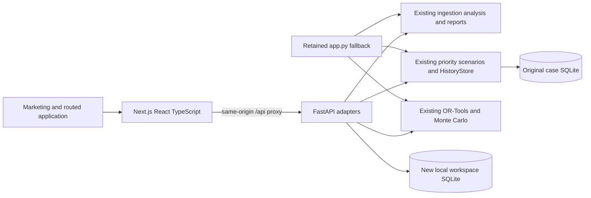

# Premium web architecture and data contract

## Composition

No algorithm was reimplemented in TypeScript. `backend/main.py` imports the
original functions and dataclasses. The original `src/` modules and Streamlit
application are unchanged by the migration. All existing business tests remain.

## Routes

| Page | Real data source |
| --- | --- |
| `/` | API-computed demo preview; original SVG/CSS artwork |
| `/app` | analyze_shipments, calculate_kpis, carrier_performance |
| `/app/shipments` | persisted uploaded/demo rows, original quality rules |
| `/app/exceptions` | prioritize_shipments and active_exception |
| `/app/decisions` | default_assumptions, compare_actions, original history matching |
| `/app/decisions/history` | HistoryStore list/create/update/export |
| `/app/optimization` | generate_planning_demo, adjust_planning, solve/compare_strategies |
| `/app/analytics` | saved V3 experiment/simulation details and run_evaluation |
| `/app/settings` | persisted PriorityConfig; validation delegated to the original class |

Next pre-renders HTML shells and fetches workspace data in the browser. A static
build classification is not a claim that business outputs are hardcoded. A stopped
API shows an error; absent experiments show an empty state.

## API inventory

| Method and endpoint | Purpose |
| --- | --- |
| GET `/api/health` | Process readiness |
| GET/POST `/api/datasets` | List persistent datasets / validate CSV or Excel upload |
| GET `/api/workspace` | Filtered KPIs, paginated rows, priority queue, quality findings and charts |
| GET `/api/exports/{kind}` | Full filtered shipments/exceptions/priorities/quality CSV or English report |
| GET `/api/demo/{csv,xlsx}` | Original V1 synthetic examples |
| GET `/api/settings` | Applied priority configuration and actual capability descriptions |
| PUT `/api/settings/priority` | Validate and persist explicit settings |
| GET `/api/decisions/defaults` | Existing Python scenario defaults |
| POST `/api/decisions/compare` | Calculate supplied assumptions for an active exception |
| GET/POST `/api/cases` | Query / save a server-recomputed, idempotent decision |
| PATCH `/api/cases/{id}` | Validate observed outcomes, using optimistic version control |
| GET `/api/cases/export` | Case history CSV |
| GET `/api/evaluation` | Original independently referenced synthetic V2 evaluation |
| POST `/api/optimization/runs` | Compute and persist a genuine V3 experiment |
| GET `/api/optimization/runs/latest` | Last saved experiment; 404 if none exists |
| GET `/api/optimization/runs/{id}` | Retrieve a saved experiment |
| GET `/api/optimization/runs/{id}/export/{kind}` | Complete JSON, comparison/allocation/candidate CSV |

Interactive request schemas are served by FastAPI at `/docs` on port 8000.

`workspace` accepts dataset_id, as_of, carrier, mode, status, q, offset and limit.
The API analyzes the full input before filtering, retaining original cost thresholds.
Metrics, charts and exports use the same selection; pagination only limits displayed
shipment rows. The UI requests 20 rows; the API accepts at most 500 per page.
Workspace summary/quality previews are capped at 500. /api/exceptions provides server pagination and ID filtering for the full queue; case CSV export is complete.

The upload contract is the original V1 contract, with its 20 MB/100,000-row limits
and field-level quarantine rules. A file without required columns is rejected;
individual bad dates/costs and duplicates are reviewable. Uploaded provenance is
unverified and never automatically declared real or synthetic.

## Persistence and isolation

- `web_datasets`, `web_settings`, `web_runs` live in
  `data/local/web_workspace.sqlite3` by default.
- The original `HistoryStore` uses `data/local/exception_history.sqlite3`.
- Environment overrides are `LOGISTICS_WEB_DB_PATH` and `LOGISTICS_DB_PATH`.
- Parameterized SQL and original case validation are retained. New tables do not
  replace, clear or rewrite existing cases.
- Browser localStorage only remembers dataset/date. Raw uploads and experiments
  stay on the local Python server and survive an API process restart.
- Priority settings persist for this local web workspace. They do not overwrite
  `config/priority_rules.json` or Streamlit session preferences.
- Saved decisions use the applied assumptions; cost and delay are recalculated on
  the server. Repeated identical saves reuse a content-derived submission key.
- Updates include expected_version. Conflicting updates return HTTP409.

This is one authenticated organization per independent instance, not shared multi-tenant SaaS.
`backend/access.py` hashes passwords and opaque sessions, binds both DBs to a server-side instance identity, and enforces viewer/operator/admin roles through the ASGI boundary. No client tenant field grants access. Unsafe requests require an allowlisted Origin; all business APIs/downloads require authentication.
See [pilot operations](PILOT_OPERATIONS.md) for offline provisioning, body/solver/storage budgets, retention, backup/restore and HTTPS requirements. Streamlit is disabled when LOGISTICS_PILOT_MODE=1. Public deployment is not validated.

## V3 assumptions and limits

The UI generates separate planning inputs because V1 uploads lack service costs,
capacity and uncertainty data. It never fabricates those fields on uploaded orders.
Existing V3 constraints, integer rounding, objectives and solver status semantics
remain authoritative; see `V3_TECHNICAL_REPORT.md`.

All strategies use the same constraints and scenario draws. FEASIBLE is explicitly
not proven optimal; UNKNOWN is not treated as infeasible. Failed solves have no
reported cost or benefit. Risk is an assumed lognormal probability, not a carrier
history statistic. The API caps interactive planning at 500 orders and ten seconds
per strategy. Allocation/simulation tables preview 100 rows; exports are complete.

## Frontend and runtime

Next.js App Router, React, TypeScript, Tailwind, locally owned shadcn-compatible
Radix/CVA primitives, Lucide icons, Recharts and Motion. Manrope is bundled from
Fontsource, so runtime font fetching is unnecessary. Original SVG geometry and a
single compositor-friendly CSS hero animation avoid a WebGL runtime dependency.
Reduced-motion CSS disables animation; labels, focus states, drawers, empty/error
states and loading skeletons are implemented.

`scripts/start_web.py` starts and stops both process trees. The production API
proxy targets loopback8000; Next uses3000 by default, or a supplied frontend port.
Dependency downloads need internet; synthetic analysis needs no external service.
Streamlit's original launch command remains available independently.
